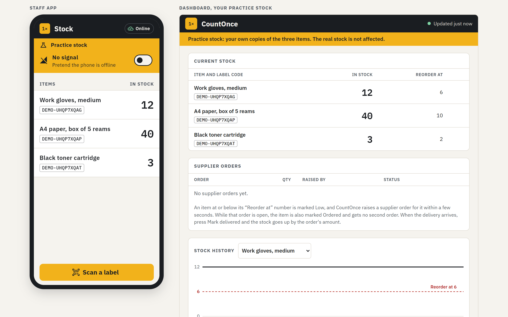
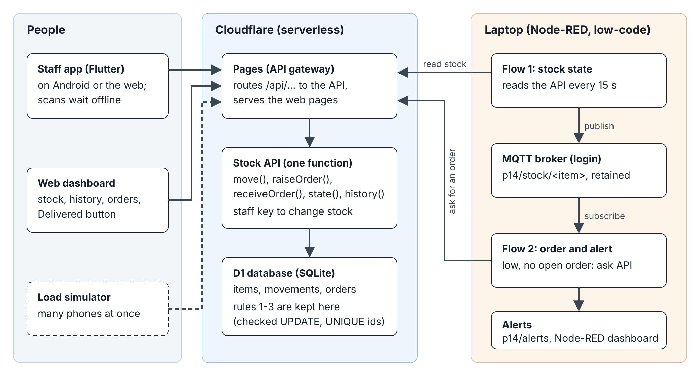

# CountOnce

Shared stock counts that stay right, even offline.

**[Try it](https://countonce.pages.dev/try)** · [Dashboard](https://countonce.pages.dev) · [API](https://countonce.pages.dev/try-api) · [Walkthrough video](https://countonce.pages.dev/demo.mp4) · [Android app](https://github.com/belumume/countonce/releases/latest)



A store room keeps a count of every item, and several people change it at once from their phones.
CountOnce follows three rules:

1. **Stock that is not there is never handed out.** Two people taking the last pair of gloves at the
   same moment: one gets it, the other is told no.
2. **One scan is counted once.** If a phone loses the reply and sends the scan again, the stock
   still goes down by one. Scans made with no signal wait on the phone and are sent when the signal
   returns.
3. **One shortage is ordered once.** When an item falls to its reorder level (the stock level at
   which it should be restocked), CountOnce raises a supplier order automatically, and never two for
   the same shortage.

The database itself refuses to let a count go below zero, to count a scan twice or to open a second
order while one is still open for the same item, so the rules hold even if the server restarts mid-request. The phone keeps scans
made without signal until it can send them.

## Try it

The [Try it page](https://countonce.pages.dev/try) puts the real staff app next to the real
dashboard, on practice stock of your own. Take 6 of the 12 pairs of gloves out. That brings them
down to their reorder level of 6, so a supplier order appears. Switch on **No signal** and take 1 more out, and the scan waits on the
phone. Switch the signal back on, and it is counted once. Further down the dashboard you can replay
the two mistakes that rules 1 and 2 prevent: first the usual read-then-write way, then with CountOnce.

The real stock cannot be changed without the staff key.

## How it works



| Part | Built with | Job |
|---|---|---|
| API | TypeScript on Cloudflare Pages Functions (serverless) | The only thing that changes stock |
| Database | Cloudflare D1 (SQLite) | Holds the stock, every change and the orders, and refuses what the three rules forbid |
| Staff app | Flutter (Android and web) | Take stock out or put it in by scanning shelf labels; scans made without signal stay on the phone and are sent when the signal returns |
| Dashboard | One HTML page | Shows the stock, its history, supplier orders and the two mistakes; refreshes every 3 seconds |
| Reorder flows | Node-RED (a visual automation tool) and MQTT (a lightweight messaging protocol) | Every 15 seconds, read the stock from the API and publish each item over MQTT; a second flow receives it, asks the API for a supplier order when an item runs low, and shows the order on an alerts page |

The core of rule 1 is one statement, with the check inside the change:

```sql
UPDATE items SET qty = qty + ?1 WHERE id = ?2 AND qty + ?1 >= 0
```

Rule 2 is a `UNIQUE` request id made by the phone at the moment of the scan; rule 3 is a partial
unique index allowing one open order per item. [`docs/how-it-works.md`](docs/how-it-works.md) follows
one scan from the phone to the supplier order and back, with measured response times and the
results of failure and load tests.

## Run it

Needs Node.js 22 or newer.

```
npm install
npm run db:local     # once: creates the local database
npm run dev          # then open http://localhost:8788
npm run check -- http://localhost:8788   # fires the two mistakes at the local server and prints what happened
```

To test the staff app, run `cd app && flutter test`. To build it and serve it at `/app/`, run
`npm run build:app`. How to run the reorder flows in containers, and how to deploy, are
in [`docs/running.md`](docs/running.md).

Built as course project P14 (Platform-based Development).

## Licence

MIT
