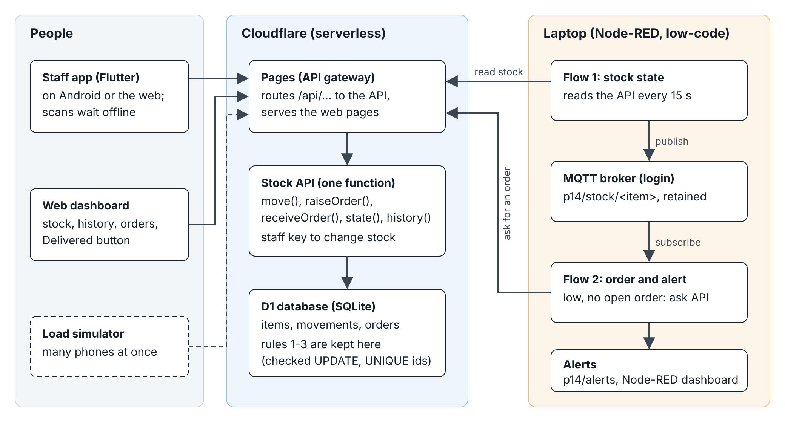
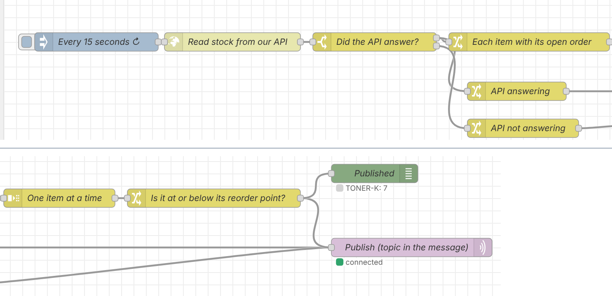
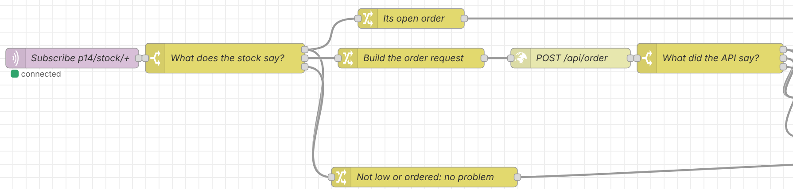
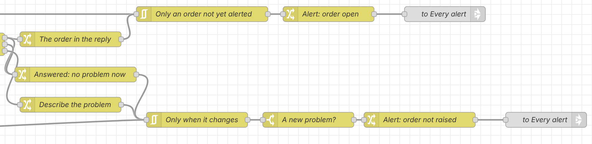
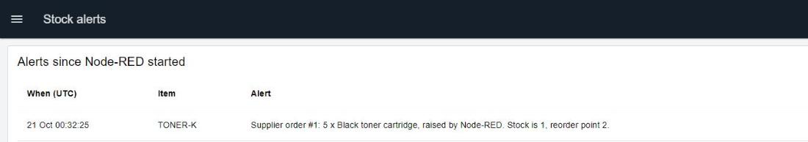

# How CountOnce works

CountOnce was built for a university course on platform-based development in November 2026. The
README says how to run and deploy it; this file explains the whole system and why it is built the way
it is.

## 1. The problem

A store room keeps a count of every item. Two things must never go wrong:

1. **Stock that is not there must never be handed out.** If one pair of gloves is left and two
   workers ask for it at the same moment, only one may be told yes.
2. **One action must never be counted twice.** A phone sends "took 1 out", the network drops before
   the answer comes back, and the phone sends it again. The stock must go down once, not twice.

And one thing must not be forgotten: **when an item runs low, someone must order more** before it
runs out.

CountOnce does all three. It is "cloud-native": built from cloud services from the start, with no computer
of ours running the main part, in separate parts that only talk through fixed interfaces.

## 2. The parts



- **The API** (the set of web addresses a program calls to ask for something) is the only thing that
  changes stock. Everything else asks it.
- **The database** (D1, Cloudflare's managed SQLite) stores the stock and enforces the three rules.
- **The web dashboard** is for managers: current stock, history, supplier orders.
- **The staff app** (Flutter, Android and browser) is for workers: take stock out, put it in, even
  with no network.
- **Node-RED** is the low-code part: it watches the stock and orders more when it runs low. It talks
  over **MQTT**, a messaging system where a sender **publishes** a message to a named **topic** and
  every listener **subscribed** to that topic receives it.

No part knows how the others are built; the app does not know Node-RED exists. That is **loose
coupling**: any part can be changed or replaced without touching the others.

## 3. One action from start to finish

Work gloves start at 12. Their **reorder point** is 6 (at or below 6 they need ordering) and their
**reorder quantity** is 12.

| Step | What happens | What changes |
|---|---|---|
| 1 | A worker taps "Work gloves, medium" in the staff app, chooses `Take out`, sets 6 and presses `Take 6 out` | The app gives the action a **request id** (a long random string made at that moment) and saves it on the phone in the **outbox**, the list of actions waiting to be sent |
| 2 | The app sends "request id X, gloves, minus 6, from this worker" to the API | Nothing yet |
| 3 | The API sends two statements to the database together: write a line in the **ledger** (the `movements` table) and lower the stock, but only if enough is there | Ledger line marked `applied`. Gloves: 6 |
| 4 | The API answers "applied, stock is 6". The app removes the action from the outbox | Outbox empty |
| 5 | The dashboard reads the stock every 3 seconds, so within a few seconds (its next read) it shows 6 | Nothing |
| 6 | Within 15 seconds Node-RED's flow 1 reads the stock and publishes the gloves' state (6, reorder point 6, low, no open order) on `countonce/stock/GLOVE-M` | Nothing |
| 7 | Flow 2, subscribed to that topic, sees "low, no open order" and asks the API: "order gloves" | Nothing yet |
| 8 | The API checks the stock itself, takes the quantity (12) from the item's own settings and writes a supplier order | `orders` has order #N, 12 gloves, `open`; the dashboard tags the gloves `Ordered` |
| 9 | Flow 2 sends an alert to `countonce/alerts` and to the Node-RED dashboard | Nothing |
| 10 | The delivery arrives. A manager presses `Delivered` on the dashboard (the page asks for the staff key once per tab) | In one go: a ledger line "+12, supplier delivery", gloves go to 18, order #N becomes `received` |

## 4. Each part, closer

### 4.1 The API and the database

The API is one **serverless function** (`src/index.ts`): Cloudflare starts it when a request arrives
and stops it when idle, so there is no server to set up or look after. Cloudflare Pages serves the
web pages and sends every address that starts with `/api/` to the function
(`functions/api/[[path]].ts`). In layer terms: the page is the client, Pages is the gateway, the
function is the logic, D1 is the data.

| Table | One row per | Main columns |
|---|---|---|
| `items` | item | id, name, qty, reorder_point, reorder_qty |
| `movements` (the ledger) | stock change, applied or refused | request_id, item_id, delta, staff, outcome |
| `orders` | supplier order | request_id, item_id, qty, raised_by, status (open or received) |

| Route | What it does |
|---|---|
| `GET /api/state` | Current stock, the last 20 movements, open and recent orders |
| `GET /api/history?item=...` | One item's movements, with the stock after each |
| `POST /api/move` | Take out or put in (the staff app) |
| `POST /api/order` | Ask for a supplier order (Node-RED) |
| `POST /api/order/received` | Record a delivery (the Delivered button) |
| `POST /api/move-unsafe`, `POST /api/reset` | Only for the throwaway `DEMO-` items of the dashboard's demonstration (section 4.3) |
| `POST /api/visitor`, `GET /api/state?visitor=...` | A visitor's own three practice items: create them, then read only them (section 4.6) |

**The staff key.** Changing real stock needs a secret sent in the `x-staff-key` header. Reading needs
no key. Status codes: 200 done (201 new order), 400 badly formed, 401 no key or wrong key, 403 a real
item sent to a demo-only route, 404 no such item, 409 refused (not enough stock, order not needed or not set up, or
a request id reused for a different item or amount), 500 an unexpected server error, 503 the stock
changed while an order was being raised (try again; Node-RED does).

### 4.2 The three rules

Each rule lives in the database itself, as a table rule (`CHECK`, `UNIQUE`, an index) or inside the
one statement that changes the stock. None depends on a program reading first and deciding later.

**Rule 1: never hand out stock that is not there.** The obvious way is "read the stock, check it,
write the new stock". Between the read and the write there is a gap: two requests can both read
"1 left" before either writes, and both are told yes. That is a **race condition**. CountOnce puts the
check inside the change:

```sql
UPDATE items SET qty = qty + ?1 WHERE id = ?2 AND qty + ?1 >= 0
```

`?1` is the change (for example -6), `?2` the item id. The database does this as one step, so nothing
can come between the check and the change. The ledger line and the stock change go to D1 as one
**batch**, which D1 runs as a **transaction**: all of it happens or none of it. The second request
for the last unit finds 0 and gets 409. As a last guard the table refuses negative stock:
`CHECK (qty >= 0)`.

**Rule 2: never count the same action twice.** The phone makes the request id when the button is
pressed and keeps it with the action. The ledger's `request_id` column is `UNIQUE`. If the phone
sends the same action again, the database refuses the second line, the batch is undone, and the API
returns what happened the first time (`repeatOf()`). Sending again is always safe; the word is
**idempotent**. The idea is the idempotency key that payment APIs such as Stripe use.

**Rule 3: never order the same shortage twice.** A partial unique index on `orders`:

```sql
CREATE UNIQUE INDEX one_open_order_per_item ON orders (item_id) WHERE status = 'open'
```

Among open orders each item may appear once. However often Node-RED asks, a second open order cannot
be written. Once received, the order is no longer open, so the next shortage can be ordered. The API
also decides whether the item is really low and how many to order, so a false or stale message
cannot create a false order.

**Delivered** uses the same idea: the ledger line, the stock going up and the order marked received
are three statements in one batch, each acting only while the order is open. Pressing Delivered
twice adds the stock once.

Where to point in the code: `move()` at `src/index.ts` line 73, `repeatOf()` line 106,
`raiseOrder()` line 313, `receiveOrder()` line 362; `CHECK` at `migrations/0001_init.sql` line 5 and
`UNIQUE` at line 13; the index at `migrations/0003_supplier_orders.sql` line 21.

### 4.3 The web dashboard and the labels page

`public/index.html` is one page of HTML, CSS and JavaScript, served with the API. Every 3 seconds it
reads `GET /api/state` and redraws: stock with `Low` and `Ordered` tags, supplier orders with a
`Delivered` button (asks for the staff key and keeps it only until the tab closes), a history chart
from `GET /api/history`, and "Demonstration: the two cases", which runs the obvious way against the
real API on throwaway `DEMO-` items that never appear in the stock list.

`public/labels.html` (served at `/labels`) prints a Code 128 barcode label for each item, which the
staff app's camera scanner reads.

### 4.4 The staff app

Flutter: one codebase builds the Android app (APK) and the browser app at `/app/`.

| Layer | Code | Job |
|---|---|---|
| Screens | `app/lib/ui/`: `home_page.dart`, `scan_page.dart`, `sign_in.dart` | What the worker sees and taps |
| Logic (view model) | `StaffLogic` in `app/lib/logic.dart` | Holds what the screens show; puts each action in the outbox and sends it |
| Data | `app/lib/data/`: `StockApi` in `api.dart`, `Outbox` in `outbox.dart` | The only code that talks to the API; the actions saved on the phone |

**Offline.** Every action goes into the outbox first, saved with `SharedPreferences`, with its
request id. Staff and each visitor have separate outboxes, so a visitor never sends a staff scan, and each
change re-reads the stored outbox, so two tabs of the site never lose each other's scans. Every 5 seconds the app sends what is waiting, oldest first, and stops at the first one
with no answer, so actions arrive in the order they were made. Closing the app loses nothing. A lost
answer means the same action with the same id is sent again, and rule 2 counts it once.

**Scanning.** `mobile_scanner` reads the labels. On a Samsung Galaxy A52 it opened GLOVE-M from its
label on 11 November 2026.

**Tests.** 45 tests. 7 run the logic against a fake API (offline actions wait and go in order; a lost
answer is resent with the same id and counted once; a refused action is not retried; the outbox
survives a restart; a wrong key keeps the action until the right key is entered; two server-error
cases). 6 check the screens: how times and signed changes read, and that the Take out / Put in sheet
shows the stock before and after, is named for a screen reader with both numbers labelled, warns when a take-out is more than the stock, and counts the scans
still waiting. 26 cover visitor mode (section 4.6): the visitor id, creating and re-creating
the practice items, no staff key on a visitor's moves even with one saved, a real shelf label opening the
visitor's copy of that item, No signal keeping scans on the phone with no network call and then sending each
once with the same id, No signal and the waiting scans surviving a reload, leaving visitor mode, and the
sign-in button, banner, switch and guide fitting a 360-pixel screen. Of these, 9 check that staff mode and
visitor mode never touch each other's scans, staff key or staff name: each has its own queue and sends only its own scans, the
playground frame leaves the saved visitor and the staff queue alone, two tabs never lose each other's scans,
and leaving the demo while it starts never puts demo items in the real stock. 6 check that a browser which used an earlier
version of the web app keeps its waiting scans, staff key and settings after the storage names changed, with a
queue saved under both names merged, in scan order, so no scan is lost. (The Android app now has its own package id, so it
installs as a new app: send any waiting scans from an older APK before removing it.)

### 4.5 Node-RED and MQTT

`nodered/flows.json`: 43 nodes on three tabs, plus five configuration nodes, and no function nodes.
The formulas inside nodes (the low-stock test, the order request, the alert text) are **JSONata**
expressions, which were the hardest part to read and test: a flow with no function nodes still holds code.

| Tab | What it does |
|---|---|
| MQTT broker | A broker (`aedes`) inside Node-RED, on port 1883, with a login |
| 1. Stock state | Every 15 s: read `/api/state`, split it into one message per item, publish each to `countonce/stock/<id>` (QoS 1 and retained, both explained below). Whether the API answered goes to `countonce/api` |
| 2. Supplier order and alert | Subscribed to `countonce/stock/+`. Low with no open order: `POST /api/order`. Every alert goes through one node, "Every alert", to `countonce/alerts` and the dashboard at `/dashboard` |









- **QoS 1** (at least once): the broker resends until the listener confirms, so a message can arrive
  twice. Rule 3 makes that harmless.
- **Retained**: the broker keeps the last message on each topic and hands it to anyone who subscribes
  later, so a late listener knows every item's state at once.

**Why a timer and not a push from the API?** The API is in the cloud and Node-RED runs on an ordinary
computer. That computer can call the cloud, but the cloud cannot open a connection to a computer on a
home or phone network. So Node-RED asks every 15 seconds, and an order follows up to 15 seconds after the stock
falls.

**What low-code did well and where it fell short.** Reading an API, splitting a list, testing a
threshold and publishing were standard nodes, set up rather than programmed. But a flow forgets its
memory when Node-RED restarts, and two copies would not share it. So the rule that must never break,
one order per shortage, lives in the database.

### 4.6 Visitors: the playground

Anyone can try the system at `/try` without the staff key. The page makes a visitor id (8 capital
letters or digits), asks the API to create that visitor's three items (`POST /api/visitor`: copies of
the real items, with `DEMO-` ids, so they need no key and never appear in the real stock list), then
shows two things side by side: the real staff app in visitor mode (`/app/?visitor=<id>`) and the real
dashboard in visitor view (`/?visitor=<id>`).

- **The app** in visitor mode sends no key, works only on the visitor's items (a real shelf label opens the visitor's copy of that item), and shows a banner saying
  so. Its **No signal** switch makes every request fail before it leaves the app, so the scan waits in
  the outbox exactly as with no network, and is sent once, with the same request id, when it is switched off.
- **The dashboard** in visitor view shows the visitor's items, orders and history. For these items the
  dashboard does Node-RED's job: after each read it sends the same request, "order this item", for any
  item at or below its reorder point with no open order. The API decides and the database allows one
  open order per item, as for real stock; the visitor then presses Mark delivered, which needs no key for a
  demo item. Visitors' items do not depend on a Node-RED process being up.

`/try-api` lets a visitor call the API from the page. A visitor with the app on a phone can scan a label
on `/labels` straight from a computer screen: in visitor mode a real label opens the visitor's own copy.

### 4.7 Serverless or containers

The project's first goal was to compare the two, so both were built: the same API in a container
running `workerd` (the open-source runtime behind Cloudflare Workers, started by Wrangler, Cloudflare's
command-line tool) with a SQLite file, and Node-RED in a second container
(`docker-compose.yml`).

| | Serverless (live API) | Container |
|---|---|---|
| First request after 20 idle minutes | About 0.5 s, then about 0.13 s (one of three rounds was slower; section 5) | 2.9 to 4.0 s from nothing; no wait if kept running |
| Cost at this size | Free plan (see section 5) | A paid always-on server, for example $7 a month for Render's smallest instance (Render pricing page, 18 Nov 2026) |
| Upkeep | None; HTTPS automatic | Ours |
| Memory | Cloudflare's, 128 MB limit per function | API about 540 MiB, Node-RED about 110 MiB |

The container numbers are an upper bound: the image starts the API through Wrangler, which adds size,
start time and memory. The conclusion holds either way: a container kept running is paid for all day,
and one that stops when idle pays a start-up wait. So the API is serverless, and Node-RED is not,
because it holds a broker (open connections) and a timer, while a serverless function only runs while
it answers a request.

## 5. How we know it works

The results below come from a container run on 20 October 2026, live runs on 21 October and 3 and 11 November
2026, and the CI runs. A check counts as passing only
when the live API gives the expected answer; a control is a run of the obvious way that must fail, to
show the checks can see a failure. CI is GitHub Actions, which runs the checks, the simulator and the
app tests on every pull request and every push to `main`.

| What | Result | When |
|---|---|---|
| Failure-case checks (`demo/check.mjs`) on the live API | 30 checks pass, plus 2 controls that show the obvious way failing | 21 Oct and 3 Nov 2026 |
| The obvious way, no added pause, live | Handed out 2 units from 1 in 237 of 240 tries | 11 Nov 2026 |
| Load simulator, live, seed 7, so the same scans and the same network trouble can be replayed (8 phones, requests duplicated, answers lost, some late) | 295 requests for 200 scans: 118 applied, 82 refused because stock ran out (the right answer), final stock exactly right | 11 Nov 2026 |
| Stopped partway (crash) and resumed | Final stock right | every pull request and push to `main`, in CI |
| One scan, live | Median 320 ms (95th percentile 326 ms) | 11 Nov 2026 |
| Scan to the dashboard's data | Median 630 ms (95th percentile 2,265 ms), plus up to 3 s for the page's next read | 11 Nov 2026 |
| Cold start, live | First request after 20 idle minutes: 2,278 ms in round 1, 489 and 542 ms in rounds 2 and 3. Round 1 stayed slow for its follow-up requests too (median 309 ms, against 129 and 126 ms) | 11 Nov 2026 |
| Rows read per stock read (D1's own count) | 271 before two indexes were added, 33 after, on the live database's ledger then | 21 Oct 2026 |
| Same count, re-measured when the ledger held a single movement, none of it real | 17, because the movement list read 1 row instead of up to 20; 33 stays the figure for a full list | 3 Nov 2026 |
| Android release APK on a Galaxy A52 (Android 14) | A take-out made offline waited, then was sent once when the network returned; a barcode scan opened the item | 3 and 11 Nov 2026 |

The 11 November live runs were made over a home connection with no VPN; Cloudflare's Marseille
site answered every request, so each one travelled there and back. The scripted runs (checks,
simulator, the obvious way, cold start) touch only their own `DEMO-` items; the phone test took one
real pair of gloves out and put it back.

**Free-plan arithmetic.** Node-RED reads every 15 s all day (5,760 requests). Two dashboard tabs (a
read every 3 s plus the history chart) and two phones (a read every 5 s) open for an 8-hour working day
add about 32,000. That is about 38,000 requests a day, under 40% of the Workers Free plan's 100,000.
D1's free plan allows 5 million rows read a day. A stock read reads a few dozen rows however many visitors
have practice items, because every query is served by an index (the real items as a key range, real orders
through `orders_real`, a visitor's own through `orders_item`, migration 0005). Measured on a test copy of the
database with 2,000 visitor rows: 12 rows for one stock read, against about 6,000 with the earlier queries.
The same load then reads well under a quarter of the allowance. The site runs on an account on the Free plan with no payment method, so the limits
stop the site with errors; they never send a bill.

## 6. Limits

| Limit | Next step |
|---|---|
| One staff key for everyone; reading the stock is public | A login per person, with roles |
| Node-RED runs as one process on one computer; when it is off, no orders are raised for real stock (the API and app keep working) | An always-on host with a hosted broker, so the API can push instead of being polled |
| An order follows up to 15 seconds after the stock falls | The push above |
| The Android app was tested on one phone | More phones |
| Actions waiting on a lost phone are lost | Accepted for this scope |
